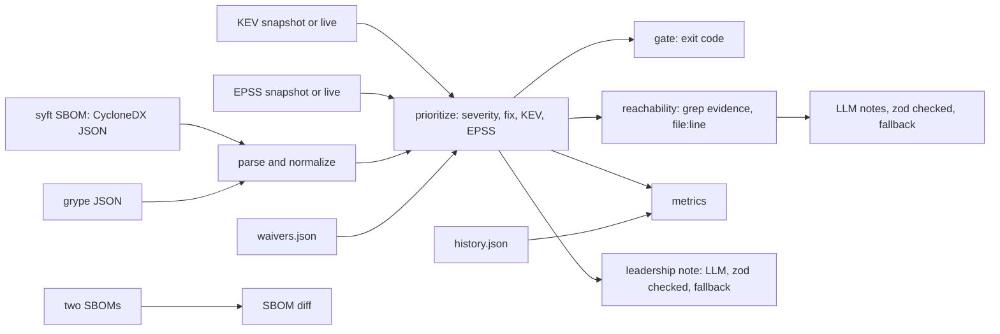

# 05 SBOM and vulnerability triage

A CLI and a composite GitHub Action. Syft produces a CycloneDX SBOM, Grype scans it, and this
piece turns the raw findings into a short, ordered list: what to fix now, what to plan, what to
watch. It also writes a plain-language note for leadership, compares the SBOMs of two releases,
and prints three numbers you can track over time.

## For engineering leaders

**The problem.** A scanner reports hundreds of findings and a team cannot fix hundreds of things.
Someone has to decide which few matter this week, and that triage takes analyst hours on every
release while the real risk sits in a long list.

**What this proves.**

- The order of the list comes from rules you can read: severity, whether a fix exists, whether the
  CISA Known Exploited Vulnerabilities (KEV) catalog lists the CVE, and its EPSS score (the
  estimated chance of exploitation in the next 30 days). No model decides the order.
- Reachability notes cite `file:line` from a search of your source. When the search finds nothing
  the note says "unknown". It never says "not reachable", because a text search cannot prove that.
- The model writes the notes and the leadership summary. Code checks what it wrote and falls back
  to a plain template, labeled as such, when the output is invalid.
- Two releases are compared by their SBOMs, so you can see what changed in your dependencies.
- The CI gate fails a build on a short, explainable rule: an unresolved finding at or above a
  severity you choose that is in KEV or above an EPSS threshold.

**The metric to track.** Three numbers, printed by `sbom-triage metrics`.

| Metric                | How this piece measures it                                                                                         | What good looks like                         |
| --------------------- | ------------------------------------------------------------------------------------------------------------------ | -------------------------------------------- |
| Open criticals        | Unresolved findings with severity Critical in the current scan. Waived findings are excluded and counted apart.    | Falling release over release, ideally zero.  |
| Mean time to remediate | Mean days from first seen to resolved, over findings your history file marks resolved. Also shown for Critical only. | Falling. Compare with your own past figures. |
| Analyst triage time   | An estimate: findings that need a human decision times minutes per finding (default 15, your assumption) against reading every finding. | Falling as rules absorb routine decisions.   |

No outside benchmark is cited. "Good" is your own trend. Triage time is an estimate built on the
minutes-per-finding number you supply. Replace it with a measured number from your tracker when
you have one.

**Adopt it in a week.**

1. Day 1: run `sbom-triage report` on one repository with the committed demo fixtures, to see the
   outputs. Read the limits below.
2. Day 2: run Syft and Grype on your own code with `--live`, and keep a `waivers.json` for
   accepted risks. Every waiver needs an owner, a reason and an expiry.
3. Day 3: start a `history.json` from your tracker (first seen and resolved dates) so mean time to
   remediate has data.
4. Day 4: add the Action to a pull request workflow with `fail-on: critical`, in report-only mode
   first, then enforce.
5. Day 5: review the leadership note with the people who will read it.

**Limits.**

- Reachability is a text search. A hit means "the package is imported here" or "a function name
  from the advisory appears here". It does not trace calls, and it does not prove exploitability.
  No hit means unknown.
- Priority is only as good as the inputs: the KEV and EPSS data you load, and the severity Grype
  reports. The committed KEV and EPSS snapshots are synthetic demo data, not real catalogs.
- Syft and Grype find packages their catalogers know. Vendored code, binaries and private
  registries can be missed.
- The committed Grype output is hand-authored in Grype's JSON shape because no vulnerability
  database was available when it was written. Severities and fix versions in it are illustrative.
- Mean time to remediate needs a history you keep. Without one it prints "no data".
- This does not patch anything, open pull requests, or decide that a risk is acceptable.

## For engineers

### Architecture



Deterministic code orders the findings, evaluates the gate and computes the metrics. The model
only writes prose from evidence the code hands it, and its output is validated before use.

### Install and run

```bash
pnpm install
pnpm demo:05                       # the whole demo, offline
pnpm --filter @adl/sbom-vuln-triage triage report --app NAME:GRYPE_JSON:SRC_DIR
```

Commands. Every command is offline unless you pass `--live` or `--live-feeds`.

```text
sbom-triage report  --app NAME:GRYPE_JSON:SRC_DIR [--app ...] [options]
sbom-triage gate    --app ... --fail-on critical [options]     exit 1 when the gate fails
sbom-triage metrics --app ... [options]
sbom-triage diff    --from OLD_SBOM --to NEW_SBOM
sbom-triage report  --live --path DIR [options]                runs syft and grype on DIR

options:
  --sbom FILE            CycloneDX JSON for an app (repeatable, same order as --app); only for counts
  --kev FILE             KEV snapshot (default fixtures/kev-snapshot.json)
  --epss FILE            EPSS snapshot (default fixtures/epss-snapshot.json)
  --symbols FILE         vulnerability id to function-name hints (default fixtures/symbols.json)
  --history FILE         remediation history (default: none, MTTR prints "no data")
  --waivers FILE         accepted risks (default: none)
  --as-of YYYY-MM-DD     the date used for ages and waiver expiry (default: today, UTC)
  --epss-threshold N     EPSS above this counts as likely exploited (default 0.1)
  --minutes-per-finding N  assumption for the triage-time estimate (default 15)
  --fail-on LEVEL        critical (default), high, medium or low; used by the gate
  --show LIST            sections to print: table,notes,leadership,metrics,gate
  --audit FILE           gate only: append the decision to a hash-chained JSONL audit log
  --out DIR              write findings.json, report.md and leadership.md here
  --live                 run syft and grype (needs both installed and a Grype database)
  --live-feeds           fetch KEV from CISA and EPSS from FIRST instead of the snapshots
  --llm-live             call the model (needs ANTHROPIC_API_KEY; model from ANTHROPIC_MODEL)
```

The model is never called unless `--llm-live` or `DEMO_LIVE=1` is set. By default the CLI answers
from recorded responses in `fixtures/llm/`, and falls back to the deterministic text when a
recording is missing. The committed recordings were written by a scripted stand-in
(`demo/record-llm.ts`), not by a real model, because no API key was used to build this piece.
Re-run that script after you change a prompt or the demo inputs; a test fails when they are stale.

### Prioritization rules

Applied in order, first match wins. "EPSS high" means the score is strictly above
`--epss-threshold`. A CVE with no EPSS entry counts as 0 and is flagged "EPSS missing".

| Tier | Meaning    | Rule                                                              |
| ---- | ---------- | ----------------------------------------------------------------- |
| P0   | fix now    | In KEV, or severity Critical with EPSS high.                      |
| P1   | this sprint | Severity Critical, or severity High with EPSS high.               |
| P2   | plan       | Severity High, or severity Medium with EPSS high.                 |
| P3   | monitor    | Everything else.                                                  |

Inside a tier the order is: EPSS descending, severity, fix available first, then id. A finding
with no fix keeps its tier and its action reads "no fix released: mitigate or accept with a
waiver". Fix availability sets the action text and the sort, and decides whether a P2 finding needs
a human (see below). Findings from Grype that use a GHSA id are looked up in KEV and EPSS through
the CVE listed in `relatedVulnerabilities`.

A finding needs analyst review when it is P0 or P1, or P2 with no fix. Everything else is queued
as a routine dependency bump. Reachability is reported next to the tier. It does not change it.

### Reachability evidence

For each finding the tool searches the app source directory (`.js .mjs .cjs .ts .tsx .py`,
skipping `node_modules`, `.git` and virtual environments) for:

- an import of the package, such as `require('lodash')` or `from jinja2 import ...`
- a function name from `symbols.json` for that vulnerability, in a file that imports the package

| Evidence found                        | Verdict                    |
| ------------------------------------- | -------------------------- |
| Import and an advisory function name  | `import-and-symbol-found`  |
| Import only                           | `import-found`             |
| Nothing                               | `unknown`                  |

There is no "not reachable" verdict. The model receives only the evidence lines and may cite only
those `file:line` values. Notes that cite a location the search did not return, or that say a
package is not reachable or confirmed exploitable, are rejected, retried once, then replaced by
a deterministic note that lists the evidence. Findings with no evidence never reach the model.

### SBOM diff

`sbom-triage diff --from old.cdx.json --to new.cdx.json` lists added, removed, upgraded and
downgraded components, matched on package URL without the version. The demo compares the two
committed `shop-api` SBOMs (1.0.0 and 1.1.0).

### Waivers

`waivers.json` lists `{ id, package, reason, owner, expires }`. A waiver removes a finding from the
unresolved set, the gate and the open-criticals count, and the report lists it as waived. An
expired waiver (expires on or before `--as-of`) is ignored and the report says so.

### GitHub Action (contract for piece 12)

`pieces/05-sbom-vuln-triage/action.yml` is a composite action.

| Input          | Default    | Meaning                                                                                                   |
| -------------- | ---------- | --------------------------------------------------------------------------------------------------------- |
| `path`         | `.`        | Directory to scan.                                                                                        |
| `fail-on`      | `critical` | Severity threshold: `critical`, `high`, `medium` or `low`.                                                |
| `epss-threshold` | `0.1`    | EPSS above this value counts as likely exploited.                                                         |
| `waivers`      | empty      | Path to a waivers file, relative to the workspace.                                                        |
| `live-feeds`   | `true`     | Fetch KEV and EPSS live. Set `false` to use the committed snapshots, which are synthetic demo data.       |

The action runs Syft on `path`, scans the SBOM with Grype, runs `sbom-triage gate` and fails the
job when an unresolved finding at or above `fail-on` is in KEV or above the EPSS threshold. The
job summary gets the prioritized table. Syft and Grype must already be on the runner's `PATH`; the
action stops with a clear message if they are not. Install them in an earlier step, pinned by
commit SHA.

```yaml
permissions:
  contents: read
steps:
  - uses: actions/checkout@<sha>
  - run: ./install-syft-and-grype.sh # your pinned install step
  - uses: frankTurtle/rollcage/pieces/05-sbom-vuln-triage@<sha>
    with:
      path: .
      fail-on: critical
```

### Config reference

There is no config file. Every setting is a flag above, so a run is reproducible from its command
line. Thresholds live in code (`src/prioritize.ts`) and are exposed only as `--epss-threshold`.

### How to extend

- Another input format: add a parser that returns the `Finding` type in `src/types.ts`.
- Another evidence source (call graph, a language server): return the same `Evidence` records from
  `src/reachability.ts`. Keep "no evidence" as `unknown`.
- Another package ecosystem: add its import pattern and module-name rule in `src/reachability.ts`.

### Tests

```bash
pnpm --filter @adl/sbom-vuln-triage test
pnpm --filter @adl/sbom-vuln-triage coverage   # floor: 90% lines
```

Tests never run Syft or Grype, never touch the network and never call a model. The live runner and
the feed fetchers take injected functions that the tests replace with fakes. Each acceptance
criterion below has a test.

Acceptance criteria:

1. A Grype report and a CycloneDX SBOM parse into normalized findings and components.
2. A KEV member is P0. A Critical with EPSS above the threshold is P0. The other tier rules hold.
3. Findings sort by EPSS, severity, fix availability and id inside a tier.
4. A GHSA finding is matched to KEV and EPSS through its related CVE.
5. A finding with no fix keeps its tier and gets the no-fix action.
6. Reachability evidence carries `file:line` for imports and for advisory function names.
7. No evidence gives `unknown`, and the code has no "not reachable" verdict.
8. Invalid model output is retried once, then replaced by the deterministic note, labeled.
9. A note citing a location outside the evidence, or claiming "not reachable", is rejected.
10. The leadership note is rejected if it names a CVE that is not in the findings.
11. The SBOM diff reports added, removed and upgraded components between two releases.
12. Open criticals, mean time to remediate and the triage-time estimate are computed from inputs.
13. The gate fails on an unresolved finding at or above `fail-on` that is in KEV or above the EPSS
    threshold, and passes otherwise.
14. A waiver removes a finding from the gate. An expired waiver does not.
15. Live mode runs Syft and Grype only through the injected runner. Default runs never do.
16. `action.yml` declares the `path` and `fail-on` inputs with the documented defaults.

### Runtime dependencies

- `zod`: validates every file read and every model response.
- `@adl/shared` (workspace): LLM interface, structured output with retry and fallback, record and
  replay, demo helpers.
- `tsx`: runs the TypeScript CLI without a build step.

### Security notes

- Scanned source and SBOM contents are untrusted. They are read as data, never executed, and the
  model prompt marks evidence lines as quoted data.
- No secrets in fixtures. The model key is read from the environment only.
- `--live` spawns `syft` and `grype` with fixed argument lists, with no shell.
- `--live-feeds` and `--llm-live` are the only network paths, and both are opt-in.

### Verify before you deploy

I could not prove these offline. Run them once before you rely on the Action:

```bash
# 1. Real scanner output parses. Needs a Grype database (grype db update downloads one).
grype db update
pnpm --filter @adl/sbom-vuln-triage triage report --live --path "$PWD/pieces/05-sbom-vuln-triage/demo/apps/node-app"
# 2. Real feeds parse.
pnpm --filter @adl/sbom-vuln-triage triage report --live --live-feeds --path "$PWD/pieces/05-sbom-vuln-triage/demo/apps/python-app"
# 3. The Action on a throwaway branch of the repository, with Syft and Grype installed by pinned steps.
```

The Grype JSON fields read here (`matches[].vulnerability.id`, `.severity`, `.fix.versions`,
`.fix.state`, `relatedVulnerabilities[].id`, `artifact.name`, `.version`, `.purl`) come from
Grype's documented JSON output. The CLI flags used (`syft dir:PATH -q -o cyclonedx-json`,
`grype sbom:FILE -q -o json`) were checked against `syft --help` and `grype --help` at Syft 1.57
and Grype 0.122, but neither tool was run end to end. Step 1 is what confirms them against the installed version.
