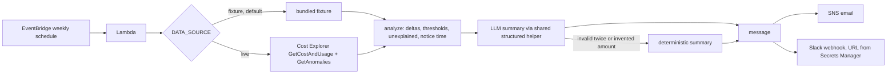

# 08 AWS cost explainer

An AWS SAM app that runs every Monday, compares last week's AWS spend with the week before, and
posts a plain-English summary to Slack or email. The arithmetic is done in code. The model only
writes the words.

## For engineering leaders

**The problem.** AI-assisted teams ship more services, more experiments and more background jobs,
and the AWS bill moves with them. Most teams read it once a month, after the invoice closes, so a
runaway resource can bill for weeks before anyone looks.

**What this proves.**

- Week-over-week changes by service and by one cost allocation tag (for example `team`) are
  computed from Cost Explorer data by deterministic code, not by a model.
- AWS Cost Anomaly Detection findings are folded into the same message, so one note covers both.
- Spend that went up and that nobody said to expect is counted separately, as "unexplained
  spend".
- The model writes the explanation from numbers it is given. If its answer is invalid or quotes a
  dollar figure that is not in the input, the app sends a deterministic summary and says so.
- The webhook URL lives in Secrets Manager, never in code. The function can read cost data and
  nothing else in your account.

**The metrics.**

- Unexplained spend: the week's material increases (above both thresholds below) that are not on
  your `EXPECTED_CHANGES` list, in dollars and as a share of the week's total.
- Time to notice an anomaly: days from the anomaly's start date to the report that mentions it.
  The report also prints how long the same anomaly would have gone unseen if you only read the
  monthly invoice, so the gain is visible.

"Good" is your own trend: unexplained spend that shrinks as people add expected changes and fix
what is not expected, and a time to notice that stays under the schedule interval (7 days for the
default weekly run). This piece does not claim a number for you. The demo numbers are made-up
fixture data.

**Adopt it in a week.**

1. Day 1: pick a cost allocation tag your teams already use, and activate it in the Billing
   console (Cost Explorer cannot group by a tag until you do).
2. Day 2: enable Cost Anomaly Detection with at least one monitor if you have not.
3. Day 3: deploy the stack in fixture mode (the default) to a sandbox account and read the
   Monday message it sends. DEPLOY.md has the commands.
4. Day 4: switch to live mode (read-only) and compare the numbers with the Cost Explorer console.
5. Day 5: set `EXPECTED_CHANGES` and the thresholds, add the Slack webhook secret, and stop
   reading the invoice cold.

**Limits.**

- Cost Explorer API calls are billed per request. This app makes a handful per run (see
  "Cost of the API calls"). Check AWS's current price before you schedule it; this README states
  none.
- Cost Explorer data is not final. Recent days can be revised, so a week-over-week comparison on
  a Monday can move a little by Wednesday. The summary says so.
- Unexplained means "up, above the thresholds, and not on your list". It does not mean the spend
  is wrong. It means nobody has said why.
- The model sees only the aggregated figures the code computed (service names, tag values,
  amounts, anomaly ids and root cause fields). It cannot explain causes it was not shown, and the
  prompt tells it to label guesses as assumptions.
- One AWS account or one consolidated payer view, one currency, one tag key. No forecast and no
  per-resource drill-down.
- Fixture mode reports made-up data. Only live mode reports your spend.

## For engineers

### Architecture



### What is in the folder

```
src/types.ts          cost and anomaly shapes
src/analysis.ts       deltas by service and tag, thresholds, unexplained spend, notice time
src/summary.ts        facts, prompt, zod schema, amount guard, deterministic fallback
src/report.ts         runReport: ports in, report out, notifications sent
src/adapters.ts       Cost Explorer, SNS, Secrets Manager and Slack adapters (thin, no decisions)
src/fixture-data.ts   the fixture week used by tests, the demo and fixture mode
src/metrics.ts        unexplained spend and time-to-notice, printed by the demo
src/lambda/           handler config and entry point
src/bin.ts            CLI: print a report, optionally from live data
template.yaml         SAM template (schedule, function, topic, log group, least-privilege role)
scripts/build-lambda.mjs   bundles the handler with esbuild into dist/lambda
DEPLOY.md             what the stack creates, cost, deploy and teardown commands
demo/                 the offline demo (see DEMO.md)
```

### Install and run

```bash
pnpm install
pnpm --filter @adl/aws-cost-explainer cost-explainer report            # fixture data, no AWS
pnpm --filter @adl/aws-cost-explainer cost-explainer report --live     # read-only Cost Explorer, your credentials
pnpm demo:08                                                            # the offline demo
```

`--live` makes read-only Cost Explorer calls with the default AWS credential chain and prints the
message. It never sends anything. Add `DEMO_LIVE=1` and `ANTHROPIC_API_KEY` to also call the model;
without them the deterministic summary is used.

### Config reference (Lambda environment)

| Variable                   | Default      | Meaning                                                                 |
| -------------------------- | ------------ | ----------------------------------------------------------------------- |
| `DATA_SOURCE`              | `fixture`    | `live` reads Cost Explorer. Anything else uses the bundled fixture.     |
| `TAG_KEY`                  | `team`       | Cost allocation tag to group by.                                        |
| `MIN_DELTA_USD`            | `25`         | A change is material only if its absolute size is at least this.        |
| `MIN_DELTA_PCT`            | `20`         | and its size relative to last week is at least this percent (new spend always qualifies). |
| `EXPECTED_CHANGES`         | empty        | Comma-separated service names whose increase is expected.              |
| `TOPIC_ARN`                | empty        | SNS topic for the email notification.                                   |
| `SLACK_WEBHOOK_SECRET_ARN` | empty        | Secrets Manager secret whose value is the Slack webhook URL.            |
| `ANTHROPIC_KEY_SECRET_ARN` | empty        | Secrets Manager secret holding an API key. Empty means no model call.   |
| `ANTHROPIC_MODEL`          | shared default | Model id, read through the shared config. Never hard-coded here.      |

### Acceptance criteria (each has a test)

1. Deltas by service and by tag are computed in code from two weeks of data: previous, current,
   absolute change and percent change, sorted by absolute change.
2. A change is material only when it clears both thresholds. New spend (nothing last week) is
   material when it clears the dollar threshold, and its percent change is reported as null.
3. Untagged spend (Cost Explorer returns the tag key followed by `$` with no value) is reported
   as "(untagged)".
4. Unexplained spend is the sum of material increases on services not in `EXPECTED_CHANGES`.
   Decreases never count.
5. Each anomaly gets a time to notice in whole days (report date minus start date) and the days
   until month end, so the gain over a monthly read is stated.
6. The summary comes from the model only when its JSON validates and every dollar figure in it
   appears in the computed facts. Otherwise the deterministic summary is sent and the message says
   the model output was not used, with the reason.
7. Invalid model output is retried once, then falls back (shared structured helper).
8. The prompt contains only computed aggregates and tells the model to label assumptions.
9. Notifications go to every configured channel. One channel failing does not stop the others. If
   all fail the run fails.
10. The Slack webhook URL must be an `https://hooks.slack.com/` URL and comes only from the secret.
11. The Cost Explorer adapter sums daily results, follows pagination, issues only the two read
    calls, and the template grants only `ce:GetCostAndUsage` and `ce:GetAnomalies` for cost data.
12. Fixture mode is the default. Live mode needs `DATA_SOURCE=live` exactly.
13. Template guardrails: `nodejs24.x`, arm64, no wildcard actions, no webhook URL or key in the file.

### How to extend

Add a channel by implementing `NotifyPort` in `src/adapters.ts` and listing it in
`src/lambda/index.ts`. Add a second grouping (account, region) by adding a call to `CostPort` and a
section in `analysis.ts`; thresholds and the unexplained rule stay in one place.

### Tests

```bash
pnpm --filter @adl/aws-cost-explainer coverage     # floor: 90% lines
pnpm --filter @adl/aws-cost-explainer typecheck
pnpm --filter @adl/aws-cost-explainer validate     # sam validate --lint, offline
```

No test calls AWS, Slack or the model. They use fakes, and `FakeLlm` for model replies.

### Runtime dependencies

| Package                          | Why                                                          |
| -------------------------------- | ------------------------------------------------------------ |
| `zod`                            | Validate model output and config.                            |
| `@adl/shared`                    | LLM client, structured output helper, demo helpers (workspace). |
| `tsx`                            | Run the CLI and demo without a build step.                   |
| AWS SDK v3 `client-cost-explorer`, `client-sns`, `client-secrets-manager` (dev) | Bundled into the Lambda file by `build:lambda`, as piece 04 does. |
| `esbuild` (dev)                  | The bundle step.                                             |

### Cost of the API calls

Per run the function makes two `GetCostAndUsage` calls per week-pair per grouping (service, tag),
so four, plus one `GetAnomalies` call, plus pagination if a result is large. Cost Explorer API
requests are billed per request. Check the current price at https://aws.amazon.com/aws-cost-management/aws-cost-explorer/pricing/
before you schedule the function. This README states no price because it did not read the page.

### Security notes

- The role can call `ce:GetCostAndUsage` and `ce:GetAnomalies`, `sns:Publish` on one topic, and
  `secretsmanager:GetSecretValue` on the secrets you pass in. Nothing writes to your account.
- The Slack webhook URL and the model key are read from Secrets Manager at run time and never
  logged. A failed secret read is not cached.
- Cost data goes to the model provider's API when you enable it. Service names and tag values can
  be sensitive in some organisations; leave `ANTHROPIC_KEY_SECRET_ARN` empty to keep them local.
- Live mode is opt-in at deploy time (`DataSource=live`) and on the CLI (`--live`).

### Verify before you deploy

Nothing here has been deployed or run against AWS. Before relying on it, a maintainer should
check, in a sandbox account:

```bash
cd pieces/08-aws-cost-explainer
sam validate --lint --template-file template.yaml
pnpm --filter @adl/aws-cost-explainer build:lambda
sam build
# then the deploy command in DEPLOY.md, with DataSource=fixture first
```

Unverified: that `GetAnomalies` and `GetCostAndUsage` accept the exact request shapes the adapter
builds (written from the SDK types and docs, not run); that the tag grouping returns `team$` for
untagged spend as documented; that the `ce:*` actions cannot be scoped below `*`; and the price of
the API calls.

### Status

Draft for review. Tested with fakes and fixtures only.
