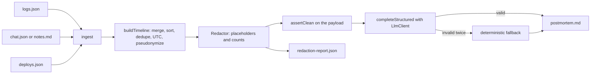

# 09 Postmortem drafter

A CLI that turns an incident bundle (exported CloudWatch logs, a chat export or markdown notes, and
a deploy list) into a draft blameless postmortem in markdown. The timeline is built by code. Every
value that looks like personal data or a secret is removed before anything reaches the model. The
model writes the narrative sections. If its output is invalid, you get a deterministic draft that
says so.

## For engineering leaders

### The problem

After an incident, the postmortem is the first thing to slip. Someone has to read logs, scroll
chat and line up deploys by hand, and that work competes with the next sprint. DORA's guide
associates higher AI adoption with higher delivery instability (see
[docs/sources.md](../../docs/sources.md); flagged VERIFY), so teams shipping with AI assistance
should expect more incidents to learn from, not fewer.

### What this proves

- A first draft exists when the bridge call ends, built from evidence the team already has.
- The timeline is computed, not generated: merged, sorted, deduplicated and in UTC, so it does not
  depend on a model getting times right.
- Nothing sensitive leaves your environment. Emails, phone numbers, IP addresses, cloud keys,
  tokens, private keys and card-like numbers are replaced with stable placeholders before the
  model sees the text. A test asserts this on every payload the fake model receives.
- The draft is blameless by construction: people in the chat and deploy list become
  `participant-N`, contributing factors are labeled hypotheses, and action item owners are blank
  for the team to assign.
- When the model fails or returns something invalid, the draft still comes out, and says it was
  generated without a model.

### The metric

Two numbers, computed by `postmortem metrics` from a file you keep:

| Metric                               | How this tool measures it                                                | Good looks like                                      |
| ------------------------------------ | ------------------------------------------------------------------------ | ---------------------------------------------------- |
| Time from incident close to publish  | Hours between `closed_at` and `postmortem_published_at`, median and p90. | Falling over time. This tool sets no numeric target. |
| Share of incidents with a postmortem | Closed incidents with a published postmortem, over all closed incidents. | Rising toward your own policy, for example all Sev1 and Sev2. |

The published time comes from your records, for example the merge time of the postmortem pull
request. The tool does not publish anything.

### Adopt it in a week

1. Day 1: export one past incident into the bundle layout below and run `postmortem draft` on it.
   Read the draft next to the real postmortem.
2. Day 2: check the redaction report against what you know was in the logs. Add a bundle from a
   noisier incident and repeat.
3. Day 3: make the export part of your incident close checklist: a CloudWatch export, the chat
   export and the deploy list.
4. Day 4: start recording `closed_at` and `postmortem_published_at` in `incidents.json`.
5. Day 5: run `postmortem metrics` and agree a target with your team.

### Limits

- It redacts patterns, not meaning. Personal names in free text, customer names and internal
  hostnames are not detected. Known chat and deploy authors are replaced, other names are not.
  Review the bundle before you use live mode, and keep the redaction report with the draft.
- Placeholders are not reversed. The draft refers to `[EMAIL_1]`, not to the address.
- Contributing factors are hypotheses drawn from the evidence in the bundle. The tool does not
  find root causes.
- Notes lines need a leading `HH:MM` time to land on the timeline. Other lines are ignored.
- Inputs without a time zone offset are read as UTC.
- One incident per run. No tracker or chat integration; you bring the exports.

## For engineers

### Architecture



`LlmClient` is the only seam to a model. The payload is built from redacted text, then checked
again: if a second redaction pass finds anything, the run stops before any call is made.

### Install and run

```bash
pnpm install
pnpm demo:09                       # offline demo on a generated bundle
pnpm --filter @adl/postmortem-drafter postmortem draft --bundle ./my-bundle --out ./out
pnpm --filter @adl/postmortem-drafter postmortem metrics --incidents ./incidents.json
```

Model access is off by default. `draft` without a model flag writes the deterministic draft.

| Flag             | Meaning                                                                         |
| ---------------- | ------------------------------------------------------------------------------- |
| `--bundle DIR`   | The incident bundle (layout below).                                             |
| `--out DIR`      | Output directory. Default `./postmortem-out`.                                   |
| `--live`         | Call the Anthropic API. Needs `ANTHROPIC_API_KEY`. `DEMO_LIVE=1` does the same. |
| `--fixtures DIR` | Replay recorded responses instead of calling a model (no network).              |

The model id comes from `ANTHROPIC_MODEL` through the shared config.

### Bundle layout

| File            | Content                                                                                                        |
| --------------- | -------------------------------------------------------------------------------------------------------------- |
| `incident.json` | `{ "id", "title", "severity", "opened_at", "closed_at" }`, times in ISO 8601.                                  |
| `logs.json`     | Output of `aws logs filter-log-events` (`{ "events": [{ "timestamp", "message" }] }`) or an array of events.  |
| `chat.json`     | Array of `{ "ts", "user", "text" }`. `ts` is ISO 8601, epoch seconds or epoch milliseconds.                    |
| `notes.md`      | Optional, instead of or with chat. Lines like `- 14:05 UTC Rolled back the deploy`.                            |
| `deploys.json`  | Array of `{ "at", "service", "version", "deployer", "status" }`; `deployer` and `status` are optional.        |

`logs.json` and `deploys.json` are required, and so is at least one of `chat.json` and
`notes.md`. Notes times are read on the incident's opening date in UTC and roll to the next day
when a time goes backwards.

### What gets redacted

| Type                    | Placeholder            | Matches                                                                  |
| ----------------------- | ---------------------- | ------------------------------------------------------------------------ |
| `private-key`           | `[PRIVATE_KEY_n]`      | PEM blocks, from the BEGIN line to the END line.                         |
| `bearer-token`          | `[BEARER_TOKEN_n]`     | `Bearer` followed by a token.                                            |
| `jwt`                   | `[JWT_n]`              | Three base64url parts starting with `eyJ`.                               |
| `github-token`          | `[GITHUB_TOKEN_n]`     | `ghp_`, `gho_`, `ghu_`, `ghs_`, `ghr_` and `github_pat_` tokens.         |
| `aws-access-key`        | `[AWS_ACCESS_KEY_n]`   | `AKIA` or `ASIA` plus 16 characters.                                     |
| `credential-assignment` | `[SECRET_n]`           | The value in `password=`, `secret:`, `api_key=` and `token:` forms, including JSON. |
| `email`                 | `[EMAIL_n]`            | Email addresses.                                                         |
| `credit-card`           | `[CARD_n]`             | 15 or 16 digit numbers, plain or grouped, that pass the Luhn check.      |
| `ipv4`, `ipv6`          | `[IPV4_n]`, `[IPV6_n]` | IP addresses.                                                            |
| `phone`                 | `[PHONE_n]`            | North American style `555-123-4567` forms and `+` international numbers. |

The same value always gets the same placeholder within a run, so the narrative can still say that
`[IPV4_1]` appears in three places. The report lists counts by type, never values.

### Acceptance criteria (each has a test)

- AC-1: the timeline merges all sources, sorts by time, removes exact duplicates and is in UTC,
  including epoch inputs and offsets.
- AC-2: each input format parses, and malformed input fails with a message that names the file.
- AC-3: every redaction type in the table above is detected.
- AC-4: placeholders are stable per value; a card-like number that fails Luhn is left alone;
  timestamps and epoch values are not mistaken for phones or cards.
- AC-5: across the planted test set, zero planted values appear in any payload the fake model
  receives (system text, prompt and the retry) or in the output markdown.
- AC-6: a valid model response produces a draft with factors marked as hypotheses and blank
  owners, and event references are checked against the timeline.
- AC-7: invalid model output (bad JSON, unknown event id, a factor stated as confirmed, a thrown
  error) is retried once, then the deterministic draft is used and says why.
- AC-8: the redaction report contains counts and types only.
- AC-9: chat and deploy authors appear as `participant-N`, including inside message text.
- AC-10: the metrics command computes the median and p90 close to publish time and the share of
  closed incidents with a postmortem, and handles open incidents and empty input.
- AC-11: the CLI runs end to end on a bundle, offline and deterministic.

### Tests

```bash
pnpm --filter @adl/postmortem-drafter coverage
```

All tests use `FakeLlm` and in-memory or temporary files. Planted secret values are assembled at
runtime from parts, so the repository holds no secret-shaped strings apart from the documented AWS
example key.

### Runtime dependencies

| Package       | Why                                                       |
| ------------- | --------------------------------------------------------- |
| `zod`         | Validate bundle files and the model's JSON.               |
| `@adl/shared` | `LlmClient`, structured-output helper, stats (workspace). |
| `tsx`         | Run the TypeScript CLI.                                   |

### Security notes

- The model sees only redacted text. A second redaction pass runs on the finished payload and
  aborts the run if it finds anything.
- The model's output is redacted too, in case it invents a value.
- The API key is read from the environment only. Live mode is opt-in.
- Redaction is pattern based. Treat it as a strong filter, not a guarantee, and read the limits.

### Status

Draft for review. Not run against a real incident or a real model: the demo uses a generated
bundle with planted fake values and a scripted stand-in for the model, both labeled in the output.
