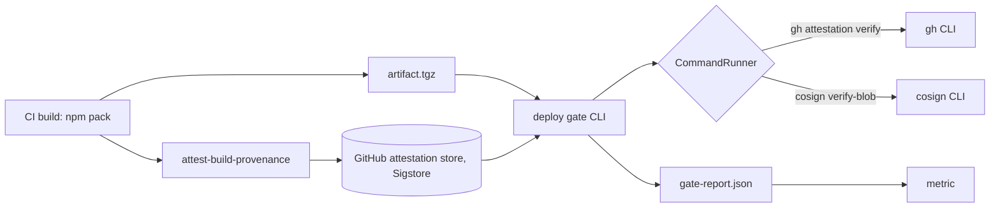

# 10 Provenance signing

A deploy gate that refuses any artifact it cannot prove came from your pipeline, plus a CI workflow
that builds a sample npm tarball and produces the proof (GitHub artifact attestations or cosign
keyless). A tampered artifact fails the gate, and the gate reports what share of deployed
artifacts were signed and verified.

## For engineering leaders

**The problem.** Code review and scanning check what you meant to ship. Nothing checks that the
file that reaches production is the file your pipeline built. A swapped tarball, a poisoned build
cache or a copy uploaded from a laptop all look the same to the deploy step unless the artifact
carries proof of where it came from.

**What this proves.**

- Every artifact the gate lets through has a signature or build attestation that verifies against
  the exact bytes being deployed.
- One changed byte makes verification fail, and the gate blocks the deploy.
- An artifact with no signature, a missing artifact, a verifier that crashes and verifier output
  the gate cannot read are all treated as failures. The gate fails closed.
- The result is one number you can report: the share of deployed artifacts that were signed and
  verified.

**The metric: % of deployed artifacts signed and verified.**

- How this piece measures it: each gate run writes a report with the artifacts checked and how
  many verified. `metric` adds up one or more reports. The number is verified artifacts divided by
  artifacts the gate was asked about.
- What good looks like: 100% for anything that reaches production. A value below 100% means a
  path to production exists that skips the gate, so track it per environment and chase the gap.
  The demo numbers come from a fixture and are not a benchmark.

**SLSA build levels in plain terms.** SLSA (Supply-chain Levels for Software Artifacts) is a
framework with levels for how trustworthy a build is. The build track in v1.0 has these levels:

| Level   | In plain terms                                                                                                  |
| ------- | --------------------------------------------------------------------------------------------------------------- |
| Build 0 | No guarantees. A person builds on a laptop and uploads the result.                                              |
| Build 1 | The build produces provenance: a record of what was built, from which source, by which process. Easy to forge.  |
| Build 2 | A hosted build service generates and signs the provenance. A user cannot forge it by hand, but a build step can. |
| Build 3 | The build service also isolates builds from each other and keeps the signing key away from the build steps.     |

Which level this piece reaches:

- The CI workflow in this folder is written to reach Build 2. It builds on a GitHub-hosted runner
  and the provenance is signed by GitHub's attestation service, outside the build steps' control.
  This is GitHub's own description of artifact attestations used in a single workflow.
- Build 3 needs the build and the attestation to run in a reusable workflow that callers cannot
  alter. GitHub documents that pattern. This piece does not implement it, so it does not claim
  Build 3.
- The attestation job runs only when started by hand (`workflow_dispatch`), because each run
  writes a public Sigstore entry. A run's provenance reaches Build 2; see "Verify before you
  deploy" for how to start one and check it.
- The offline demo signs with a throwaway local key. That shows tamper detection. It is not
  provenance and reaches no SLSA level.

Sources, read on 2026-11-25: the SLSA v1.0 levels page (https://slsa.dev/spec/v1.0/levels) and
GitHub's artifact attestations page
(https://docs.github.com/en/actions/concepts/security/artifact-attestations), which says
attestations by themselves provide SLSA v1.0 Build Level 2 and that reusable workflows can provide
the isolation for Build Level 3.

**Adopt it in a week.**

1. Day 1: pick one artifact type that reaches production (an npm package, a container image, a
   Lambda zip) and one deploy job that handles it.
2. Day 2: add the attest job to the pipeline that builds it (see `.github/workflows/piece-10-provenance-signing.yml`
   for the shape). The job needs `id-token: write` and `attestations: write` and nothing else it
   does not need.
3. Day 3: put the gate in front of the deploy step with the composite action in this folder, in
   `verify` mode. Run it in report-only mode first (`continue-on-error: true`) to see the metric.
4. Day 4: remove `continue-on-error` and require the gate in branch protection or the deploy
   environment's rules.
5. Day 5: review the failures the gate found. Each one is a path to production that skipped the
   pipeline.

**Limits.**

- A signature says who built an artifact and that it was not changed afterwards. It does not say
  the code is safe. A malicious commit that passes review gets a valid attestation.
- The gate checks the identity you configure. If you configure only the repository and not the
  workflow path, any workflow in that repository can produce an artifact that passes. Set
  `--signer-workflow` (or a certificate identity for cosign).
- Keyless signing and GitHub attestations on public repositories write to public transparency
  logs, so the repository identity becomes public record.
- Container image signing is documented below but is not exercised here. Building images in CI
  is slow, and this piece proves the same checks on an npm tarball.
- The metric counts only artifacts handed to the gate. Artifacts that skip the gate are invisible
  to it. Pair it with a list of what is actually deployed.

## For engineers

### Architecture



- The gate never calls cosign or gh directly. It builds an argument list and hands it to a
  `CommandRunner`. Tests pass a fake runner, so no test runs a real tool or touches the network.
- Three verification modes: `key` (cosign with a public key, used for the offline demo),
  `cosign-keyless` (cosign with a certificate identity and issuer) and `github-attestation`
  (`gh attestation verify`).
- `verify.ts` decides pass or fail from the runner's exit code and output together. `gate.ts`
  combines per-artifact results into allow or block and computes the metric.

### Install and run

```bash
pnpm install
pnpm demo:10                       # offline demo, throwaway key, nothing leaves the machine
pnpm --filter @adl/provenance-signing gate \
  --mode github-attestation --repo OWNER/REPO \
  --signer-workflow OWNER/REPO/.github/workflows/release.yml \
  --artifact dist/pkg-1.0.0.tgz
```

The gate exits 0 when every artifact verifies, 1 when it blocks, and 2 for bad usage.

### Gate flags

| Flag                      | Modes                      | Meaning                                                                          |
| ------------------------- | -------------------------- | -------------------------------------------------------------------------------- |
| `--mode`                  | all                        | `key`, `cosign-keyless` or `github-attestation`. Required.                       |
| `--artifact PATH`         | all                        | Artifact to check. Repeat for several. At least one is required.                 |
| `--bundle PATH`           | `key`, `cosign-keyless`    | Sigstore bundle. Default: `<artifact>.sigstore.json`. Optional for github mode (offline verification). One artifact only; with several, each uses its default. |
| `--public-key PATH`       | `key`                      | Cosign public key.                                                               |
| `--allow-no-tlog`         | `key`                      | Adds `--insecure-ignore-tlog`. For the offline demo only. See security notes.    |
| `--cert-identity VALUE`   | `cosign-keyless`           | Exact certificate identity (the workflow URL and ref). Required.                 |
| `--cert-oidc-issuer URL`  | `cosign-keyless`           | Default `https://token.actions.githubusercontent.com`.                           |
| `--repo OWNER/NAME`       | `github-attestation`       | Repository the attestation must come from. Required.                             |
| `--signer-workflow PATH`  | `github-attestation`       | `OWNER/REPO/path/to/workflow.yml` that must have signed. Strongly recommended.   |
| `--report FILE`           | all                        | Write the gate report as JSON.                                                   |

`metric --report FILE [--report FILE ...]` prints verified and total counts and the percentage.

### How the gate decides

- `key` and `cosign-keyless`: `cosign verify-blob` must exit 0 and print `Verified OK`. Exit 0
  without that line counts as ambiguous and fails.
- `github-attestation`: `gh attestation verify ... --format json` must exit 0 and print a
  non-empty JSON array in which at least one entry's statement lists a subject whose sha256 equals
  the sha256 the gate computed from the file on disk. Empty output, non-JSON output, an empty
  array or a digest mismatch all fail.
- A missing artifact, a missing bundle, a runner that cannot start the tool and a timeout all fail.
- The gate blocks if any artifact fails, and it blocks if it was given no artifacts.

### The composite action (contract for the golden path)

`pieces/10-provenance-signing/action.yml`:

| Input               | Default                       | Meaning                                                                                 |
| ------------------- | ----------------------------- | --------------------------------------------------------------------------------------- |
| `artifact`          | required                      | Path to the artifact, relative to the workspace.                                        |
| `mode`              | `verify`                      | `verify` runs the deploy gate with `gh attestation verify`. `attest` creates build provenance. |
| `repo`              | `${{ github.repository }}`    | Repository the attestation must come from (verify mode).                                |
| `signer-workflow`   | empty                         | Workflow path that must have signed (verify mode). Set it.                              |
| `bundle`            | empty                         | Offline attestation bundle (verify mode).                                               |
| `github-token`      | `${{ github.token }}`         | Token for `gh` in verify mode.                                                          |

`attest` mode requires the calling job to grant `id-token: write`, `attestations: write` and
`contents: read`. It writes to the public transparency log on public repositories, so enable it
only with the maintainer's approval. `verify` mode needs `contents: read` only.

### CI workflow

`.github/workflows/piece-10-provenance-signing.yml` has two jobs:

- `test-and-demo`: runs coverage and the offline demo. Read-only permissions. Always on.
- `attest-sample`: builds the sample tarball with `npm pack` and attests it with
  `actions/attest-build-provenance`, then runs the gate against the result. It runs only on
  `workflow_dispatch`, because it writes to the public Sigstore log with the repository identity. Only this job holds `id-token: write` and
  `attestations: write`.

Container images: after `docker build`, push the image and call `actions/attest-build-provenance`
with `subject-name` and `subject-digest`, then verify with `gh attestation verify oci://IMAGE`.
This path is not exercised here.

### Verify before you deploy

Each run writes to a public log. Run it only against the public demo repository.

1. Start it: `gh workflow run piece-10-provenance-signing.yml --ref main`.
2. Wait for it to finish. Check the attestation under the repository's Attestations page.
3. Download the artifact and verify it:

```bash
gh attestation verify pkg-1.0.0.tgz --repo OWNER/REPO \
  --signer-workflow OWNER/REPO/.github/workflows/piece-10-provenance-signing.yml
```

4. Confirm the gate accepts the same file and rejects it after a one byte change.

The gate's parsing of `gh attestation verify --format json` follows the documented output
(`verificationResult.statement.subject[].digest`). It is tested against a hand-written fixture, not
against real output. Step 3 and 4 confirm it. If the real shape differs, the gate blocks every
artifact, which is the safe failure.

### Config and extension

- Add a verifier by adding a mode in `src/verify.ts`: build the arguments, then write a parser that
  returns `verified` or `failed`. Anything the parser cannot read is `failed`.
- Swap the runner by passing a different `CommandRunner` to `runGate`. The default runs the tool
  with `execFile` (no shell) and a timeout.

### Acceptance criteria (each has a test)

- AC-1: a correctly signed artifact verifies in each of the three modes (fake runner).
- AC-2: a non-zero exit fails the artifact. Exit 0 without `Verified OK` fails as ambiguous.
- AC-3: empty, non-JSON, empty-array and wrong-digest output from `gh attestation verify` all fail.
- AC-4: missing artifact, missing bundle, runner failure and timeout all fail, with a reason.
- AC-5: the gate blocks when any artifact fails and when given no artifacts. It allows only when
  all verify.
- AC-6: the metric is verified divided by total, handles zero, and aggregates several reports.
- AC-7: the CLI argument checks reject missing required flags and unknown modes with exit code 2.
- AC-8: the exact argument lists passed to cosign and gh match the documented flags, and
  `--insecure-ignore-tlog` appears only when `--allow-no-tlog` is set.
- AC-9: no test starts a real process; the real runner is covered with a harmless local command.
- AC-10: the offline demo signs, verifies, tampers one byte, and the gate blocks. This runs real cosign, so it is checked by the demo step in CI and not by unit tests.

### Tests

```bash
pnpm --filter @adl/provenance-signing test
pnpm --filter @adl/provenance-signing coverage   # floor: 90% lines
```

### Runtime dependencies

| Package        | Why                                                          |
| -------------- | ------------------------------------------------------------ |
| `@adl/shared`  | Demo helpers (stages, headers, color).                       |
| `zod`          | Validates the gh JSON output, gate reports and CLI input.    |
| `tsx`          | Runs the TypeScript CLI and demo without a build step.       |

### Security notes

- No key is committed. The demo generates a key pair at run time inside `demo/out/`, which is
  gitignored, with an empty password, and `demo:reset` deletes it.
- Keyless signing and GitHub attestations write a public Rekor entry that includes the repository
  identity. Nothing in the default test or demo path does this.
- Offline cosign verification of a key signed bundle needs `--insecure-ignore-tlog` because the
  signature was never uploaded to a transparency log, so cosign 3 reports zero log entries
  otherwise. The demo uses it for that reason only. A real deployment should verify with the
  transparency log. Without the log you lose public auditability and a timestamp for the signature.
- Verified against cosign 3.1.5 and gh 2.98.0 help output. In cosign 3, `--tlog-upload=false`
  alone is rejected when a bundle is written. The demo adds `--use-signing-config=false`, which
  cosign marks deprecated. Expect this flag to change.
- The attest action is pinned by commit SHA. Re-check the pin when you bump it.
