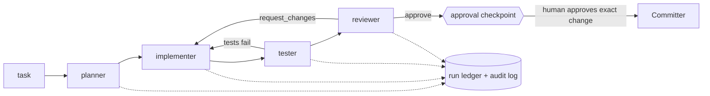

# 13 Multi-agent workflow

Four Claude Code subagents (planner, implementer, tester, reviewer) and a headless orchestrator
that runs them in order, logs every handoff, replays a recorded run exactly, and stops at a human
approval checkpoint before anything lands on a shared branch. The orchestrator is built on
[Escapement](https://github.com/frankTurtle/escapement) 0.2.0.

## For engineering leaders

**The problem.** AI agents now write changes, and when one goes wrong nobody can say which agent
decided what, from which input, or who agreed to let it merge. A chat transcript is not an audit
record, and "the AI did it" does not survive a postmortem.

**What this proves.**

- Each role is a separate agent with its own prompt and its own short list of allowed tools. The
  reviewer cannot write files. Nobody can commit.
- Every handoff is recorded: which agent ran, a hash of what it was given, what it produced, which
  tools it called, and what the workflow decided next. The record goes to a run ledger and to a
  hash-chained audit log.
- A recorded run replays exactly. If a ledger or an audit line is edited afterwards, replay and the
  chain check say so.
- A commit to a shared branch is blocked until a named human approves that exact change. No
  approval, no commit. An agent cannot approve.
- The workflow's behavior is graded in CI as a trajectory (which tools, in which order, within
  which limits), so a prompt or agent change that makes an agent behave differently shows up as a
  failed check.

**The metrics.**

| Metric                          | How this piece measures it                                                                                                                | What "good" looks like                                                                   |
| ------------------------------- | ----------------------------------------------------------------------------------------------------------------------------------------- | ---------------------------------------------------------------------------------------- |
| Agent-authored changes with a complete trace | Share of runs that have a handoff for all four roles, a ledger that replays, and a matching hash-chained audit entry for every handoff. | Every change. Anything below 100% is a gap in logging, not a rounding error.             |
| Rework rate after review        | Share of reviewed runs where the reviewer asked for changes at least once.                                                                | Your own trend. A rate near zero can mean a weak reviewer, so read it with the findings. |

`workflow metrics` prints both from a folder of run records. The demo numbers come from two
recorded fixture runs and are labeled as such.

**Adopt it in a week.**

1. Day 1: copy `agents/*.md` into `.claude/agents/` and read each prompt. Edit them for your repo.
2. Day 2: set the branches agents may commit to without approval (default `agent/*`). Everything
   else is treated as shared.
3. Day 3: run the workflow on a low-risk task with `--live`, read the handoffs, and replay the run.
4. Day 4: put `pnpm --filter @adl/multi-agent-workflow eval:gate` in CI so agent changes are graded.
5. Day 5: wire your own `Committer` (the shipped one is a dry run) and ship the audit log somewhere
   the agents cannot write.

**Limits.**

- This is a process control. It shows what happened and stops unapproved commits made through the
  orchestrator. It does not stop someone who runs `git push` by hand. Pair it with branch
  protection and piece 02.
- Escapement runs one agent per loop, so "multi-agent" here is four sequential runs chained by this
  piece's code. There is no parallelism and no agent-to-agent negotiation.
- Replay proves the recorded run reproduces. It does not prove the agent was right.
- The reviewer is a model. Its verdict is advice that the human approver reads, not a guarantee.
- The shipped committer is a dry run that records what it would commit. A real git committer is
  yours to supply.
- The audit log's tail can be truncated without detection from the file alone
  (see [ADR 0003](../../docs/decisions/0003-hash-chained-audit-log.md)).

## For engineers

### Architecture



Each box is one Escapement `run()`: a state machine with a token-budgeted context assembler, a tool
registry, and an append-only ledger. The ports are implemented here:

| Escapement port | This piece                                                                                         |
| --------------- | -------------------------------------------------------------------------------------------------- |
| `ModelProvider` | `LlmModelProvider`, an adapter over the repo's shared `LlmClient`. Tests use `FakeLlm`.            |
| `ToolRegistry`  | `buildToolRegistry`, built from the agent's frontmatter `tools`. Tests use an in-memory workspace. |
| Assembler       | Escapement's `createAssembler`, with the agent's prompt as the system section.                     |
| Eval harness    | `evals/suite.ts`: `EvalCase`s with trajectory graders, gated against `evals/baseline.json`.        |

Deterministic code decides. The orchestrator routes on tool results and on the reviewer's JSON
verdict, which is validated with zod. A reviewer reply that does not validate counts as
`request_changes` (fail closed). The model never decides whether a commit is allowed.

### The agent files

`agents/*.md` are the canonical copies. `.claude/agents/*.md` holds identical copies, and a test
fails if they drift. Format source: Claude Code subagents documentation,
https://code.claude.com/docs/en/sub-agents (read 2026-11-25). A file is Markdown with YAML
frontmatter; `name` and `description` are required, `tools` is a comma-separated list, and the body
is the system prompt.

| Agent       | Tools in frontmatter    | Maps to orchestrator tools                  |
| ----------- | ----------------------- | ------------------------------------------- |
| planner     | Read, Grep, Glob        | `read_file`, `list_files`, `search_files`   |
| implementer | Read, Grep, Glob, Write | the above plus `write_file`                 |
| tester      | Read, Grep, Glob, Bash  | the read tools plus `run_tests`             |
| reviewer    | Read, Grep, Glob        | `read_file`, `list_files`, `search_files`   |

`Bash` maps only to `run_tests`, never to a shell. A tool name that is not in the map is an error
at load time, so a typo cannot widen an agent's access.

### Model protocol

The shared `LlmClient` returns text, so each turn is a JSON object:
`{"say": "...", "tool_calls": [{"name": "...", "args": {}}]}`. The adapter validates it with zod
through the shared structured-output helper: one retry, then it fails the run closed. The model id
comes from `ANTHROPIC_MODEL` through the shared config.

### The ledger, the audit log, and replay

- Each Escapement run produces a ledger. The workflow stores them all in one run record
  (`run-<id>.json`) next to a handoff list.
- A handoff is `{seq, agent, inputHash, output, outputHash, toolCalls, decision, ledgerKey,
  ledgerDigest}`. The same facts go to the shared `AuditLogger` (actor `agent:<name>`, action
  `handoff`), which chains each line to the one before.
- Runs use Escapement's manual clock, seeded RNG and sequential ids, so a ledger depends only on
  the model's replies and the tools' results.
- `workflow replay <record>` checks three things: Escapement's reducer replay of every ledger,
  that every handoff still matches its ledger, and a full re-execution from the recorded model
  turns that must produce a byte-identical record.

### The approval checkpoint

`ApprovalGate` guards the `Committer` port. A commit to a branch that does not match
`agent_branches` needs an approval whose `changeHash` equals the hash of the proposed change. Any
edit to the change after approval invalidates it. Approvers named `agent:*` or matching a loaded
agent name are rejected. Approvals and blocked attempts are written to the audit log.

### Install and run

```bash
pnpm install
pnpm --filter @adl/multi-agent-workflow workflow run --task "Add a --json flag" \
  --run-id demo-clean --replies fixtures/replies-clean.json --out demo/out
pnpm --filter @adl/multi-agent-workflow workflow approve demo/out/run-demo-clean.json --by alice
pnpm --filter @adl/multi-agent-workflow workflow commit demo/out/run-demo-clean.json
pnpm --filter @adl/multi-agent-workflow workflow replay demo/out/run-demo-clean.json
pnpm --filter @adl/multi-agent-workflow workflow metrics demo/out
```

`run` needs either `--replies <file>` (recorded model replies, offline) or `--live` (calls
Anthropic with `ANTHROPIC_API_KEY`; opt-in). Live mode was not exercised in this repo's tests.

### Config (`workflow.yml`, all optional)

| Key                 | Default                       | Meaning                                                                 |
| ------------------- | ----------------------------- | ----------------------------------------------------------------------- |
| `agents_dir`        | `agents`                      | Where the agent files are read from, relative to the piece folder.      |
| `agent_branches`    | `["agent/*"]`                 | Branches a commit may land on without approval. Everything else needs it. |
| `max_rework_rounds` | `1`                           | Review or test rejections allowed before the run halts.                 |
| `max_steps`         | `8`                           | Escapement step budget per agent run.                                   |

### Evals

`evals/suite.ts` builds one Escapement `EvalCase` per role from the recorded fixture turns, with
graders for the tool sequence, a step limit, "never calls a commit tool", and exact replay.
`pnpm --filter @adl/multi-agent-workflow eval:gate` compares the scores and trajectory
fingerprints with `evals/baseline.json` and fails on a regression. `eval:baseline` re-records the
baseline; Escapement's own rule is to do that on a release branch only.

### Extending

- A new agent: add a markdown file, add it to the role list in `src/roles.ts`, add fixture turns.
- A new tool: add it to `src/tools.ts` and to the map of Claude Code tool names.
- A real committer: implement `Committer.commit(change)` and pass it to `ApprovalGate`.

### Tests

`pnpm --filter @adl/multi-agent-workflow coverage` runs the tests with a 90% line floor. No test
touches the network. Each acceptance criterion above has at least one test.

### Runtime dependencies

| Dependency       | Why                                                                      |
| ---------------- | ------------------------------------------------------------------------ |
| `escapement` 0.2.0 | State machine, context assembler, run ledger and replay, eval harness. Zero dependencies of its own. |
| `@adl/shared`    | `LlmClient`, structured output, `AuditLogger`, glob, config.             |
| `zod`            | Validates model turns, the reviewer verdict, and config.                 |
| `yaml`           | Parses agent frontmatter and `workflow.yml`.                             |
| `tsx`            | Runs the CLI and demo from TypeScript.                                   |

### Security notes

- Agent tools run against an in-memory workspace in tests and the demo. A real workspace adapter
  must confine paths to the repo; the shipped `Workspace` rejects absolute paths and `..`.
- Fixtures contain no credentials. The AWS example key is not used here.
- Approval is bound to a change hash, not to a run id, so approving one change never approves
  another.

### Verify before you deploy

Nothing here deploys. The one thing only a live run can show is real model behavior against the
JSON protocol. To check it:

```bash
ANTHROPIC_API_KEY=... pnpm --filter @adl/multi-agent-workflow workflow run --live \
  --task "Add a --json flag" --out /tmp/rollcage-live
pnpm --filter @adl/multi-agent-workflow workflow replay /tmp/rollcage-live/run-*.json
```

See [docs/follow-ups.md](../../docs/follow-ups.md) for what the Escapement library did not cover.
